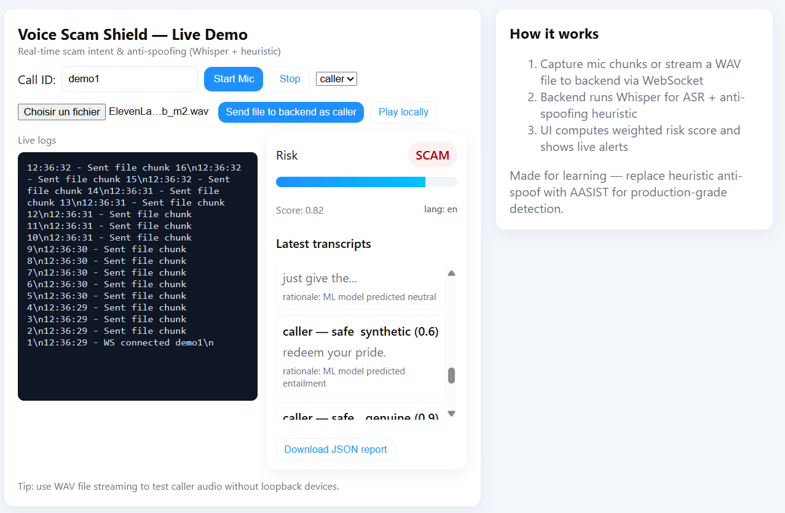
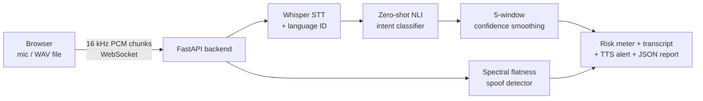

# 🛡️ Voice Scam Shield

**Real-time, multilingual scam-call detection — built at the Hack Nation x MIT Hackathon.**

Voice Scam Shield listens to a phone call *while it is happening*, transcribes every sentence with Whisper, classifies the speaker's intent with a multilingual zero-shot NLI model, checks the caller's voice for signs of synthesis, and warns the user with a live risk meter and a spoken alert — **before** any money or verification codes change hands.

<p align="center">
	
	<br>
	<em>Live demo: transcript, intent classification, spoof detection and risk scoring in real time.</em>
</p>

<p align="center">
  
  
  
  
</p>
<p align="center">
  <em>🧪 Projet de hackathon (Hack Nation × MIT Hackathon) — pas encore de licence, voir <a href="#%EF%B8%8F-disclaimer">Disclaimer</a></em>
</p>

---

## ⚠️ The Problem

- Impostor scams cost **US victims $2.7 billion in 2023** alone (US Federal Trade Commission) — and vishing (voice phishing) is growing fastest among vectors.
- Existing countermeasures block **known numbers** only. They can't help when the scammer calls from a spoofed or never-before-seen number.
- **Scams happen in real time.** Seniors don't Google "is this a scam" mid-call — they need a voice in their ear at the exact moment "read me the code on your screen" is said.
- The problem is **multilingual** by nature: fraud scripts are translated and localized constantly, which is why keyword filters keep losing the arms race.

Voice Scam Shield flips the defense: analyze the **content and voice** of the call live, in any language, and alert the human.

---

## ✨ What It Does

| Capability | How |
|---|---|
| 🎧 Live audio capture | Browser mic (WebRTC) or WAV file streaming, 16 kHz PCM chunks over WebSocket |
| 🌍 Multilingual transcription | OpenAI Whisper (auto language detection — English, French, and 90+ others) |
| 🤖 Scam-intent detection | Zero-shot classification on `joeddav/xlm-roberta-large-xnli` — flags scam / fraud / phishing **without per-language training data** |
| 🗣️ Anti-spoofing | Spectral-flatness analysis of the caller's voice to flag synthetic/TTS audio |
| 📈 Confidence smoothing | A 5-window moving average so the risk meter doesn't flicker sentence-to-sentence |
| 🚨 Human-in-the-loop alerts | Risk meter, labeled transcript trail with rationales, TTS warning ("do not share codes or money"), downloadable JSON call report |
| 🛟 Graceful degradation | Missing GPU/toolkit/model? The server *still runs* on keyword + heuristic fallbacks — the demo never hard-fails |

## 🧠 How It Works



1. **Capture** — the frontend records PCM-16 audio at 16 kHz and streams 1-second chunks over a WebSocket (live mic or any WAV file, transparently resampled in the browser).
2. **Transcribe** — each ~1s window is transcribed by Whisper (running in a thread pool so the event loop never blocks).
3. **Classify** — the transcript goes through a zero-shot NLI model. Because it classifies against *label descriptions* rather than trained classes, it generalizes across languages and scam scripts.
4. **Anti-spoof** — FFT of the caller's audio; abnormally flat / unnatural spectra are flagged as likely synthetic.
5. **Smooth & warn** — confidences are averaged over the last 5 windows; the UI computes `risk = 0.7·intent + 0.3·spoof`, tints the meter, and speaks a warning above the 0.75 threshold.

## 🚀 Quickstart

**Requirements:** Python 3.11+ (tested on 3.11) with pip.

```bash
git clone https://github.com/Plasmow/VoiceScamShield.git
cd VoiceScamShield

# (optional but recommended) create a virtual environment
python -m venv venv
venv\Scripts\activate        # Windows  —  source venv/bin/activate on macOS/Linux

pip install -r requirements.txt
```

**Run everything with one command** — the backend serves the frontend itself:

```bash
uvicorn backend.main:app
```

Then open **http://127.0.0.1:8000** , allow microphone access, pick `caller` or `user` and press **Start Mic**.

> First launch downloads model weights (Whisper ≈ 75 MB, XLM-R NLI ≈ 2 GB) and loads them in the background, so the page is reachable immediately. Everything after that runs **fully locally — no cloud, no API keys**.

### Demo script

Try saying these as the *caller*:

- ✅ Safe: *"Hello, I was calling to confirm tomorrow's appointment."* → **safe** badge
- ⚠️ Scam: *"This is the tax office, transfer the verification code to my account right now or your bank account will be blocked."* → risk meter jumps into **SCAM**, spoken warning fires
- Works in French too: *"C'est le service client, transférez le code que je vous ai envoyé"* — no French model training required

Alternatively drop any `.wav` into the file input and click **Send file to backend as caller**.

<details>
<summary><b>Running the frontend separately (optional)</b></summary>

The UI is a single static HTML file, so any static server works — it targets `ws://<host>:8000/ws/` automatically:

```bash
cd frontend
python -m http.server 5500
# open http://127.0.0.1:5500
```

</details>

## 🧪 API

| Endpoint | Description |
|---|---|
| `GET /` | Serves the demo UI |
| `GET /health` | `{status, whisper_loaded, intent_model_loaded}` — handy for monitoring |
| `WS /ws/{call_id}` | Streams `chunk` / `end_call` JSON messages in; `analysis` events and a final `report` out |

<details>
<summary>Message format</summary>

```jsonc
// client → server
{ "type": "chunk", "speaker": "caller", "timestamp_ms": 1731428400000, "audio_chunk": "<base64 PCM16 @16kHz>" }
{ "type": "end_call" }

// server → client
{ "type": "analysis", "speaker": "caller", "text": "…", "language": "fr",
  "intent_label": "scam", "intent_confidence": 0.93, "rationale": "ML model flagged: scam",
  "spoof_label": "genuine", "spoof_confidence": 0.9 }
{ "type": "report", "report": { "call_id": "demo1", "segments": [ … ] } }
```

</details>

## ⚙️ Configuration

| Env var | Default | Purpose |
|---|---|---|
| `VSS_WHISPER_MODEL` | `tiny` | Whisper size (`tiny`, `base`, `small`… — trades accuracy for latency) |
| `VSS_INTENT_MODEL` | `joeddav/xlm-roberta-large-xnli` | Any zero-shot NLI checkpoint |
| `VSS_DEBUG` | `1` | Verbose server logging |

## 🛠 Tech Stack

- **Backend:** Python · FastAPI · WebSocket · uvicorn
- **Speech-to-text:** OpenAI Whisper
- **Intent detection:** Hugging Face Transformers (zero-shot, multilingual: `xlm-roberta-large-xnli`)
- **Audio DSP:** librosa · soundfile · NumPy
- **Frontend:** single-file HTML/JS (WebRTC audio, Web Audio API resampling, SpeechSynthesis alerts)

**Why these choices for a hackathon?** Whisper + zero-shot NLI means *no labeled data, no per-language training, one offline model covering both English and French from minute zero* — the entire pipeline runs on a laptop with no cloud bills.

## 📁 Project Structure

```
VoiceScamShield/
├── backend/
│   └── main.py            # FastAPI app: WebSocket pipeline + static frontend hosting
├── frontend/
│   └── index.html         # Single-file demo UI (mic capture, file streaming, live dashboard)
├── demoimages/
│   └── demo1.png          # Screenshot
├── requirements.txt
└── .gitignore             # runs/calls/ and caches stay out of the repo
```

> `calls/*/` WAV segments (created at runtime) and `__pycache__/` are ignored by git.

## 🗺 Roadmap

- [ ] Replace spectral-flatness heuristic with an AASIST-family anti-spoofing model
- [ ] Offload ASR to a faster-whisper (CTranslate2) worker for 4× lower latency
- [ ] Rolling call-level risk score with scam-script pattern memories (RAG over known fraud scripts)
- [ ] Android/iOS dialer integration so alerts fire on real incoming calls
- [ ] Multilingual UI (i18n) to match the multilingual engine

Built with ❤️ and a lot of coffee at the **Hack Nation × MIT Hackathon**.

## ⚖️ Disclaimer

Prototype built for a hackathon. The intent classifier and anti-spoofing heuristics are **not** production-grade and will produce false positives/negatives — don't rely on it for real fraud prevention without proper evaluation.

**License:** none yet — this is a hackathon project (Hack Nation × MIT Hackathon). © 2025-2026 the Voice Scam Shield team; all rights reserved until a license is chosen. Ping us if you want to reuse the code or collaborate.
